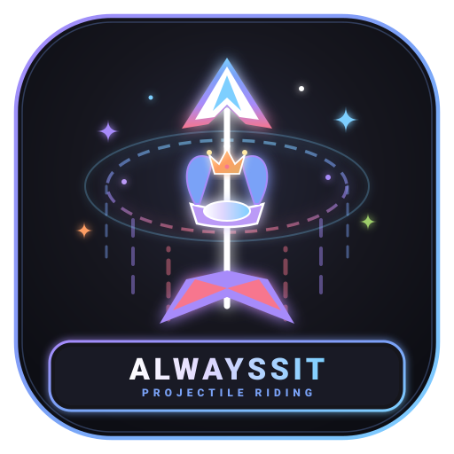

<div align="center">

<!-- Animated Header Banner in noloverme's signature style -->


<!-- Project Icon -->
<a href="https://github.com/noloverme/AlwaysSit">
  
</a>

<br/><br/>

<!-- Typing SVG Animation -->
<a href="https://github.com/noloverme/AlwaysSit">
  
</a>

<br/><br/>

<!-- Badges Row -->
<a href="https://papermc.io">
  
</a>
&nbsp;
<a href="https://www.oracle.com/java/">
  
</a>
&nbsp;
<a href="https://github.com/noloverme/AlwaysSit/blob/main/LICENSE">
  
</a>
&nbsp;
<a href="https://github.com/noloverme/AlwaysSit/actions">
  
</a>

<br/><br/>

<!-- Developer Contact Badges -->
<a href="https://t.me/noloverme">
  
</a>
&nbsp;
<a href="https://vk.com/noloverme">
  
</a>
&nbsp;
<a href="https://github.com/noloverme">
  
</a>

</div>

<br/>

> [!NOTE]
> **Весь данный проект** (архитектура, программный код плагина, кросс-версионные NMS-хуки, иконка и документация) **полностью создан с помощью искусственного интеллекта (ИИ)** по запросу [noloverme](https://github.com/noloverme).

---

<div align="center">
  
</div>

<br/>

```yaml
plugin:
  name: AlwaysSit
  version: 1.0.1
  platforms: "PaperMC / Purpur / Spigot (1.16.5 — 26.3+)"
  runtimes: "Java 11, 17, 21+"
  core_feature: "Continuous automatic mounting on the furthest projectile"
  engine: "Hybrid Bukkit API + Multi-Version NMS Reflection + Vanilla /ride"
  performance: "Optimized O(k) localized entity scanning (20.0 stable TPS)"
  credits: "Completely generated by Artificial Intelligence for noloverme"
```

---

<div align="center">
  
</div>

<br/>

<table>
  <thead>
    <tr>
      <th width="200" align="left">Функция</th>
      <th align="left">Описание</th>
    </tr>
  </thead>
  <tbody>
    <tr>
      <td><b>🎯 Furthest Projectile Tracking</b></td>
      <td>Выбранный игрок непрерывно садится на самый дальний запущенный им объект. При запуске нескольких снарядов плагин моментально перемещает игрока на лидирующий снаряд.</td>
    </tr>
    <tr>
      <td><b>✨ Anti-Flicker Trajectory</b></td>
      <td>Дистанция снарядов рассчитывается относительно базовой стартовой точки запуска. Игрок плавно летит на первом снаряде, а при выстреле вперед пересаживается только тогда, когда новый снаряд действительно обгоняет текущий.</td>
    </tr>
    <tr>
      <td><b>🛡️ Full Damage Protection</b></td>
      <td>Отключает урон стрелку от столкновения со своим снарядом в полете и автоматически сбрасывает высоту падения при приземлении/выходе.</td>
    </tr>
    <tr>
      <td><b>🌐 Ultra Cross-Version</b></td>
      <td>Работает на любых ядрах от <b>1.16.5 до 26.3+</b>. Новые ветряные заряды (<code>wind_charge</code>), ледяные шары (<code>ice_ball</code>), бризы (<code>breeze</code>), фростбайты (<code>frostbite</code>) и крикинги (<code>creaking</code>) поддерживаются автоматически, а будущие снаряды обнаруживаются на лету.</td>
    </tr>
    <tr>
      <td><b>⚡ Zero TPS Degradation</b></td>
      <td>Локализованная выборка сущностей в радиусе полета игрока без тяжелых сканирований всего мира.</td>
    </tr>
  </tbody>
</table>

---

<div align="center">
  
</div>

<br/>

### ⌨️ Команды

| Команда | Описание | Пример |
|---|---|---|
| `/asit <ник> <сущность>` | Включить постоянную посадку на самый дальний объект выбранного типа (или `all`) | `/asit Steve arrow`<br>`/asit Alex all` |
| `/asit <ник>` | Снять игрока со снаряда и удалить из списка AlwaysSit | `/asit Steve` |

* **Алиасы**: `/asit`, `/alwayssit`
* **Право доступа**: `alwayssit.use` *(по умолчанию доступно операторам `op`)*

---

<div align="center">
  
</div>

<br/>

<table>
  <thead>
    <tr>
      <th width="140" align="left">Категория</th>
      <th align="left">Идентификаторы сущностей в Tab-Complete</th>
    </tr>
  </thead>
  <tbody>
    <tr>
      <td><b>🌟 Wildcard</b></td>
      <td><code>all</code>, <code>any</code>, <code>*</code> <i>(любой запущенный объект)</i></td>
    </tr>
    <tr>
      <td><b>🏹 Стрелковые</b></td>
      <td><code>arrow</code>, <code>spectral_arrow</code>, <code>trident</code></td>
    </tr>
    <tr>
      <td><b>❄️ Метательные</b></td>
      <td><code>snowball</code>, <code>egg</code>, <code>ender_pearl</code> <i>(pearl, enderpearl)</i>, <code>eye_of_ender</code> <i>(eye)</i></td>
    </tr>
    <tr>
      <td><b>🧪 Зелья и опыт</b></td>
      <td><code>splash_potion</code> <i>(potion)</i>, <code>lingering_potion</code> <i>(lingering)</i>, <code>experience_bottle</code> <i>(exp, exp_bottle)</i></td>
    </tr>
    <tr>
      <td><b>🎆 Пиротехника</b></td>
      <td><code>firework_rocket</code> <i>(firework, rocket)</i></td>
    </tr>
    <tr>
      <td><b>🔥 Огненные заряды</b></td>
      <td><code>fireball</code>, <code>small_fireball</code>, <code>dragon_fireball</code>, <code>wither_skull</code></td>
    </tr>
    <tr>
      <td><b>💨 Новые 1.21+ / 26.3</b></td>
      <td><code>wind_charge</code> <i>(windcharge, wind)</i>, <code>breeze_wind_charge</code>, <code>ice_ball</code> <i>(ice, iceball)</i></td>
    </tr>
    <tr>
      <td><b>🎣 Прочие</b></td>
      <td><code>shulker_bullet</code>, <code>llama_spit</code>, <code>fishing_bobber</code> <i>(fishing_hook, bobber, hook)</i></td>
    </tr>
    <tr>
      <td><b>🦇 Летающие и новые мобы</b></td>
      <td><code>bat</code>, <code>blaze</code>, <code>ghast</code>, <code>phantom</code>, <code>bee</code>, <code>parrot</code>, <code>vex</code>, <code>ender_dragon</code>, <code>wither</code>, <code>allay</code> (1.19+), <code>breeze</code> (1.21+), <code>creaking</code>, <code>frostbite</code> (26.3)</td>
    </tr>
  </tbody>
</table>

---

<div align="center">
  
</div>

<br/>

Файл настроек: `plugins/AlwaysSit/config.yml`

```yaml
# AlwaysSit Configuration
# Paper / Purpur / Spigot 1.16.5 - 1.21+

settings:
  # Частота обновления проверки в тиках (1 тик = 50мс)
  tick-interval: 1
  # Отмена урона игроку от собственного снаряда в полете
  prevent-self-damage: true
  # Защита от урона при падении во время полета и при приземлении
  prevent-fall-damage: true

messages:
  prefix: "&8[&6AlwaysSit&8] "
  no-permission: "&cУ вас нет прав на использование этой команды!"
  player-not-found: "&cИгрок &e{player} &cне найден или не в сети!"
  usage:
    - "&6==== AlwaysSit Помощь ===="
    - "&e/asit <ник> <сущность> &7- включить посадку на самую дальнюю запущенную сущность"
    - "&e/asit <ник> &7- удалить игрока из списка AlwaysSit"
  enabled: "&aРежим AlwaysSit &2включен &aдля игрока &e{player}&a. Сущность: &b{entity}&a."
  updated: "&aТип сущности для игрока &e{player} &aизменен на &b{entity}&a."
  disabled: "&cИгрок &e{player} &cудален из списка AlwaysSit и больше не садится на сущности."
  not-in-list: "&eИгрок &f{player} &eне находится в списке AlwaysSit."
  target-notified-enabled: "&aДля вас &2включен &aрежим AlwaysSit на сущность: &b{entity}&a."
  target-notified-disabled: "&cДля вас &4отключен &cрежим AlwaysSit."
  invalid-entity: "&cСущность &e{entity} &cне найдена или не поддерживается. Используйте подсказки Tab."
```

---

<div align="center">
  
</div>

<br/>

### 📦 Сборка из исходного кода
```bash
mvn clean package
```
Готовый артефакт компилируется в директорию:
```text
target/AlwaysSit-1.0.1.jar
```

### 🚀 Установка
1. Скопируйте `AlwaysSit-1.0.1.jar` в папку `plugins/` вашего сервера.
2. Перезапустите сервер или используйте менеджер плагинов.
3. Настройте `config.yml` под ваши задачи.

---

<div align="center">

<!-- Animated Waving Footer Banner -->


<p>
  <sub>Разработано для сообщества Minecraft &bull; Репозиторий: <a href="https://github.com/noloverme/AlwaysSit">github.com/noloverme/AlwaysSit</a> &bull; Автор: <a href="https://github.com/noloverme">noloverme</a></sub>
</p>

</div>
